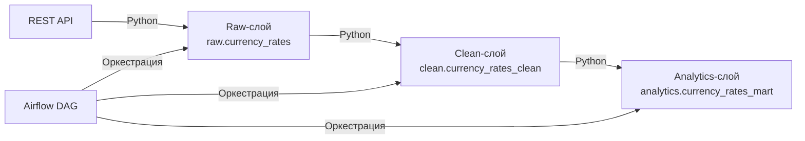

# Raw → Clean → Analytics: Трехслойный DWH пайплайн

Демонстрация классической трехслойной архитектуры хранилища данных (DWH) с оркестрацией в Apache Airflow.

## Что это такое?

Трехслойная архитектура — это стандарт для корпоративных хранилищ данных:

## Архитектура

1. Raw-слой (сырой): данные сохраняются «как есть» (без изменений). Это страховка: если что-то пойдет не так, у нас всегда есть исходник.
2. Clean-слой (очищенный): данные нормализуются (убираются дубли, приводятся типы, объединяются источники).
3. Analytics-слой (витрины): готовые таблицы для отчетов и BI.

## Что реализовано

- Raw-слой: Python-скрипт забирает данные из API (курсы валют) и сохраняет их в raw.currency_rates (JSONB).
- Clean-слой: Python-скрипт разворачивает JSON в нормализованную таблицу clean.currency_rates_clean.
- Analytics-слой: Python-скрипт строит витрину analytics.currency_rates_mart (последние курсы, топ-5 валют по курсу к USD).
- Оркестрация: DAG в Apache Airflow (raw_clean_analytics_pipeline), который запускает все три слоя по цепочке.

## Стек

- Python (Pandas, SQLAlchemy, psycopg2)
- PostgreSQL
- Apache Airflow (Docker)
- REST API

## Архитектура

REST API -> (Python) -> Raw-слой (raw.currency_rates)
Raw-слой -> (Python) -> Clean-слой (clean.currency_rates_clean)
Clean-слой -> (Python) -> Analytics-слой (analytics.currency_rates_mart)
Airflow DAG -> (Оркестрация) -> все три слоя

## Как это работает

1. Airflow запускает DAG raw_clean_analytics_pipeline (ежедневно).
2. Задача raw_layer вызывает raw_loader.py (данные из API -> raw.currency_rates).
3. Задача clean_layer вызывает clean_loader.py (JSON -> clean.currency_rates_clean).
4. Задача analytics_layer вызывает analytics_builder.py (витрина -> analytics.currency_rates_mart).

## Скриншоты

- Успешное выполнение DAG (все три слоя): [dag_success.png](dag_success.png)
- Витрина в PostgreSQL: [analytics_mart.png](analytics_mart.png)

## Ссылки

- [Основной проект DWH Marketplace Analytics](https://github.com/nconichtchenko-arch/marketplace-dwh-analytics)
- [Data Contracts Demo](https://github.com/nconichtchenko-arch/data-contracts-demo)
- [dbt CI/CD Demo](https://github.com/nconichtchenko-arch/dbt-ci-cd-demo)
